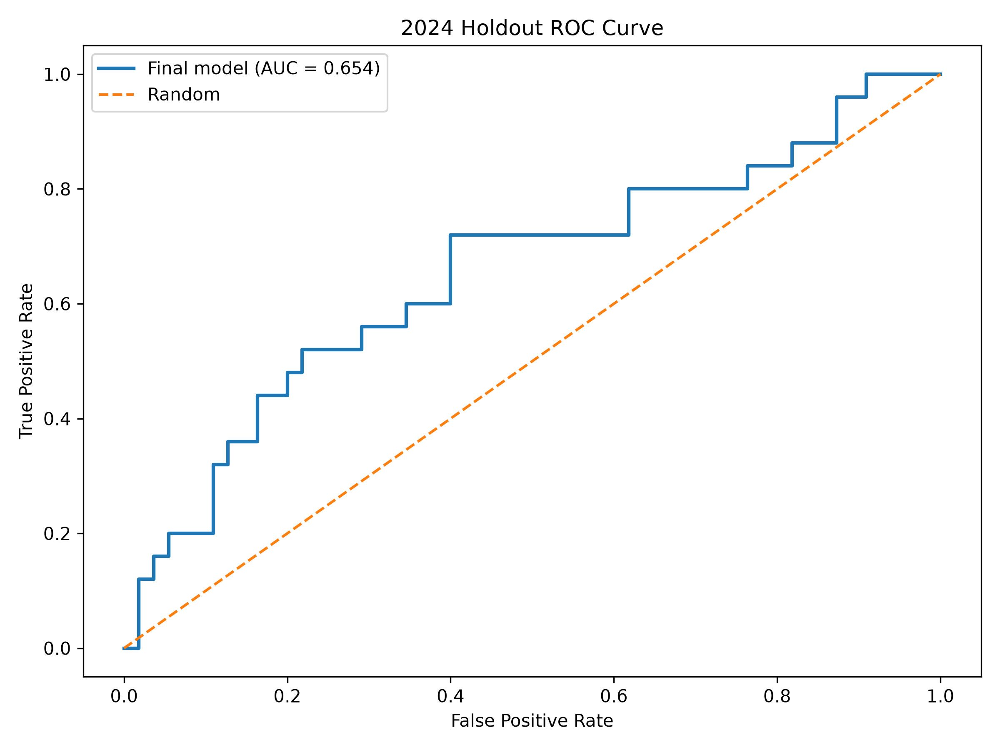
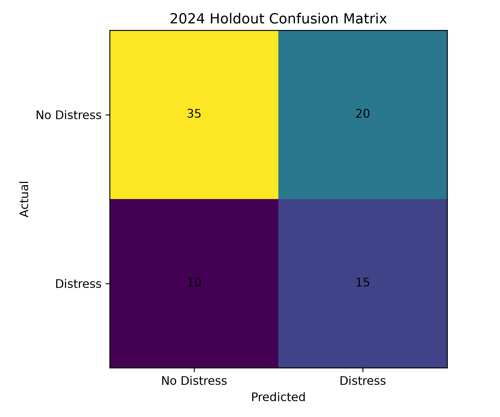
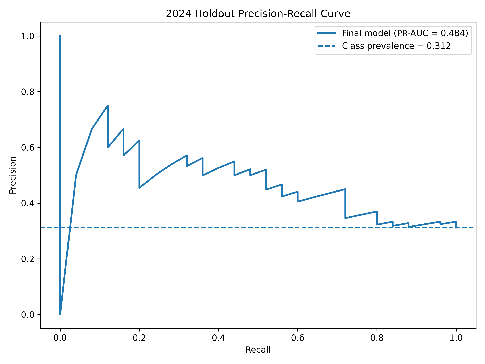
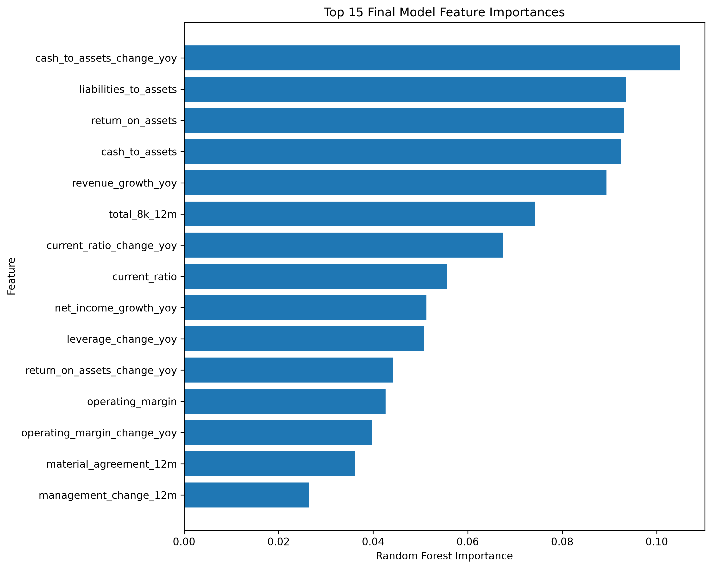
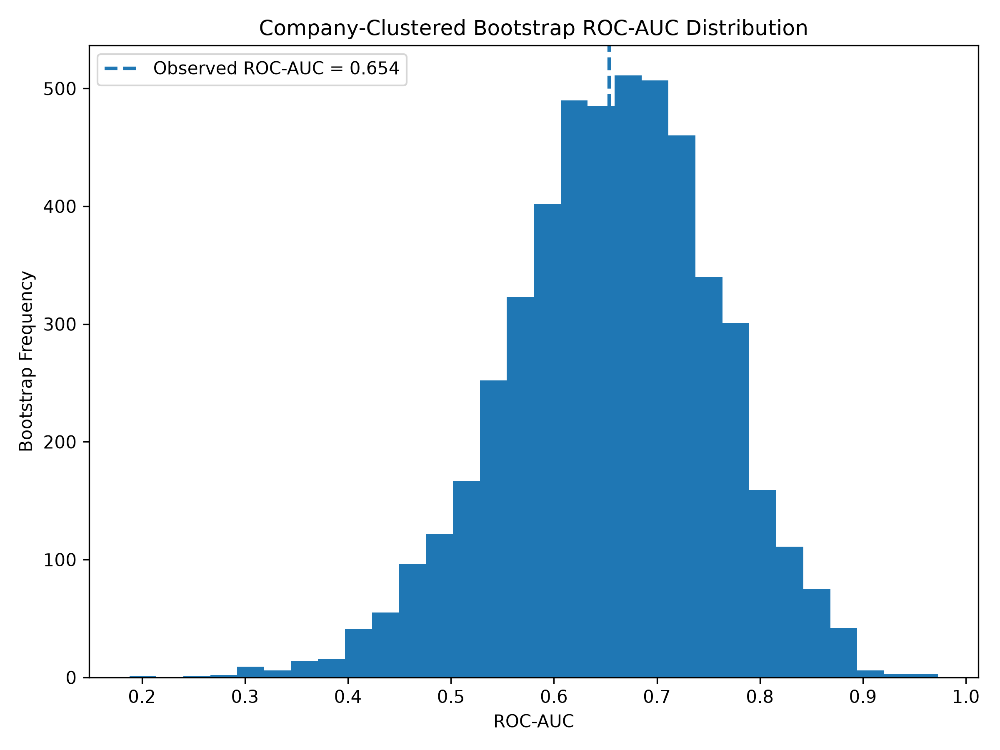

# Financial Distress Early-Warning Model

A multi-source machine-learning project that combines **SEC financial statements, SEC 8-K disclosures, historical market data, SQL, R, and Python** to estimate the risk of a major future equity drawdown.

> **Final frozen 2024 holdout:** ROC-AUC **0.654** · PR-AUC **0.484** · Recall **60%** · F1 **0.500**



## Project Overview

The goal of this project is to answer a practical question:

> **Can financial deterioration and corporate disclosure activity observable at the time of an SEC filing help identify companies at elevated risk of a major stock-price drawdown over the following year?**

I built an end-to-end pipeline covering data collection, financial feature engineering, SEC filing analysis, PostgreSQL storage, machine-learning modeling, temporal validation, robustness testing, and visualization.

### Final Dataset

| Component | Result |
|---|---:|
| Companies | **20 U.S. public companies** |
| Quarterly observations | **747** |
| Final holdout period | **2024** |
| Holdout observations | **80** |
| Final model | **Class-balanced Random Forest** |
| Distress definition | **≥30% forward peak-to-trough drawdown** |
| Forecast horizon | **252 trading days** |

---

## Target Definition

Rather than attempting to predict bankruptcy, the project defines **financial distress as severe future equity-market deterioration**.

For each quarterly company observation:

1. Start on the first trading day on or after the SEC filing date.
2. Observe the following **252 trading days**.
3. Calculate the worst **peak-to-trough drawdown** during that forward window.
4. Assign:

```text
distress_12m = 1
```

when the future drawdown reaches **-30% or worse**.

A complete 252-trading-day forward window is required for the observation to receive a label.

> **Important:** This model predicts major market drawdown risk — not bankruptcy, insolvency, or default.

---

## Data Sources

The project integrates three main sources of information.

### 1. SEC Financial Statements

Financial statement data was collected from SEC filings and transformed into fundamental indicators including:

- Revenue
- Operating income
- Net income
- Assets
- Liabilities
- Current assets
- Current liabilities
- Cash

These were converted into features such as:

- Current ratio
- Liabilities-to-assets
- Return on assets
- Operating margin
- Cash-to-assets
- Revenue growth
- Net income growth
- Year-over-year changes in liquidity
- Year-over-year changes in leverage
- Year-over-year changes in profitability

### 2. SEC Form 8-K Disclosures

Corporate event information was extracted from SEC 8-K filings.

Rolling event variables include:

- `management_change_12m`
- `restructuring_12m`
- `material_agreement_12m`
- `acquisition_disposition_12m`
- `total_8k_12m`

Management-related disclosures were additionally reviewed at the text level to distinguish executive departures, appointments, and potentially disruptive management events.

### 3. Historical Market Prices

Adjusted historical stock prices were used to construct the forward 12-month drawdown target.

---

## Project Pipeline

```text
SEC Financial Statements
          +
SEC 8-K Disclosures
          +
Historical Market Prices
          |
          v
    Data Cleaning
          |
          v
   PostgreSQL / SQL
          |
          v
 Financial Feature Engineering
          +
 Event Feature Engineering
          |
          v
 Multi-Quarter Deterioration Signals
          |
          v
 Chronological Development Split
          |
          v
     Purged Validation
          |
          v
 Random Forest Model Selection
          |
          v
   Frozen Model Specification
          |
          v
      2024 Holdout
       /    |    \
      v     v     v
 Bootstrap Error  Cross-Company
 Analysis Analysis Validation
```

---

## Feature Engineering

The model combines four types of predictors:

**Financial levels**

Examples include cash-to-assets, liabilities-to-assets, current ratio, operating margin, and return on assets.

**Financial changes**

Year-over-year changes capture deterioration or improvement rather than simply the current financial level.

**Corporate events**

SEC 8-K activity captures potentially meaningful changes that may not yet be fully reflected in accounting ratios.

**Persistent deterioration**

Multi-quarter streak variables were designed to detect deterioration that persists rather than temporary one-quarter noise.

The final candidate model retained:

```text
cash_deteriorating_3q
leverage_rising_3q
```

### Quarter-Sequence Validation

Because deterioration streaks only make sense when observations represent consecutive quarters, fiscal-period continuity was audited.

Results:

- **725** valid previous-quarter gaps
- **705** valid three-quarter sequences
- **94.38%** of observations supported valid 3-quarter sequences

Only legitimate sequences were used to construct streak signals.

---

## Model Development

Several model configurations were evaluated during development, including:

- Fundamental financial features
- Fundamental + SEC event features
- Fundamental + event + deterioration features
- Targeted deterioration-feature ablations

The final candidate was selected using **purged chronological validation**, rather than the final test set.

The winning validation specification added:

```text
cash_deteriorating_3q
leverage_rising_3q
```

to the fundamentals + events baseline.

The specification was then **frozen before evaluating the 2024 holdout**.

---

# Final Results

## Frozen 2024 Holdout

| Metric | Result |
|---|---:|
| **ROC-AUC** | **0.654** |
| **PR-AUC** | **0.484** |
| Accuracy | 0.625 |
| Precision | 0.429 |
| **Recall** | **0.600** |
| F1 | 0.500 |

The holdout contained **80 observations** from 20 companies.

### Confusion Matrix

| | Predicted No Distress | Predicted Distress |
|---|---:|---:|
| **Actual No Distress** | 35 | 20 |
| **Actual Distress** | 10 | 15 |

The model identified **15 of 25 actual distress observations**, corresponding to **60% recall**.



---

## ROC Performance


The final model achieved:

**ROC-AUC = 0.654**

This indicates moderate ability to rank higher-risk observations above lower-risk observations in the unseen 2024 holdout.

---

## Precision-Recall Performance



The final model achieved:

**PR-AUC = 0.484**

Because distress observations represent the minority class, precision-recall performance provides an important complement to ROC-AUC.

---

# What Drove the Model?

## Feature Importance



The strongest model inputs were primarily measures of financial condition and deterioration.

Leading features included:

1. Cash-to-assets change
2. Liabilities-to-assets
3. Return on assets
4. Cash-to-assets
5. Revenue growth
6. Total 8-K activity
7. Current-ratio change
8. Current ratio
9. Net-income growth
10. Leverage change

The final multi-quarter deterioration signals also contributed:

- `cash_deteriorating_3q`
- `leverage_rising_3q`

> Random Forest feature importance measures predictive contribution within the model. It should not be interpreted as evidence of causality.

---

# Persistent Financial Deterioration

One of the most interesting findings was the relationship between **persistent cash deterioration** and future distress.

### Three-Quarter Cash Deterioration

| Condition | Future Distress Rate |
|---|---:|
| No 3Q cash deterioration | **20.6%** |
| 3Q cash deterioration | **37.4%** |

The observed distress rate was therefore substantially higher following persistent cash deterioration.

### Three-Quarter Rising Leverage

| Condition | Future Distress Rate |
|---|---:|
| No 3Q leverage increase | **22.3%** |
| 3Q leverage increase | **28.5%** |

Persistent leverage growth also corresponded with higher subsequent distress rates.

These results support the idea that **the direction and persistence of financial changes can contain information beyond static financial ratios**.

---

# SEC 8-K Findings

The project also tested whether corporate disclosure activity provides additional warning information.

One important result was that **8-K filing volume by itself was not a simple distress indicator**.

Some event categories — including restructuring and material agreements — showed higher raw distress rates, but event-level statistical estimates were uncertain.

This suggests that:

> **The content and context of corporate disclosures may matter more than filing volume alone.**

`total_8k_12m` nevertheless appeared among the more important features in the final Random Forest model.

---

# Uncertainty Analysis

A single test-set score can give a misleading sense of precision, especially with a relatively small sample.

Two bootstrap procedures were therefore used.

## Observation-Level Bootstrap

| Metric | 95% Confidence Interval |
|---|---:|
| ROC-AUC | **0.514 – 0.786** |
| PR-AUC | **0.318 – 0.697** |

## Company-Clustered Bootstrap

Quarterly observations belonging to the same company are not independent.

A second bootstrap therefore resampled **entire companies** rather than individual rows.

| Metric | Company-Clustered 95% CI |
|---|---:|
| ROC-AUC | **0.445 – 0.844** |
| PR-AUC | **0.235 – 0.721** |



The wider intervals demonstrate that model uncertainty is strongly affected by the relatively small **20-company universe**.

---

# Cross-Company Generalization

A **Leave-One-Company-Out (LOCO)** experiment tested a harder question:

> Can the model generalize to a company it has never seen during training?

For each iteration:

1. One company was completely removed.
2. The model was trained on the other 19 companies.
3. Predictions were generated for the unseen company.

### LOCO Results

| Metric | Result |
|---|---:|
| ROC-AUC | **0.522** |
| PR-AUC | **0.253** |
| Accuracy | 0.642 |
| Precision | 0.247 |
| Recall | 0.265 |
| F1 | 0.255 |

Among companies where ROC-AUC could be calculated:

**Median company ROC-AUC ≈ 0.598**

Performance declined substantially compared with the chronological holdout.

This is an important limitation rather than something to hide.

The evidence suggests that the current model is more effective as a:

> **within-company temporal early-warning framework**

than as a universal prediction system for completely unseen companies.

---

# Error Analysis

The final 2024 model produced:

- **35 True Negatives**
- **20 False Positives**
- **15 True Positives**
- **10 False Negatives**

Several false positives still experienced meaningful future declines but did not cross the project's strict **-30% distress threshold**.

The error analysis also revealed company-specific differences in model behavior, reinforcing the importance of expanding the dataset before making stronger generalization claims.

---

# Key Findings

### 1. Financial fundamentals carried most of the predictive signal

Liquidity, leverage, profitability, and their changes were among the strongest model features.

### 2. Persistent cash deterioration emerged as a useful warning signal

The observed distress rate increased from **20.6% to 37.4%** following a three-quarter cash deterioration streak.

### 3. Corporate events provided context, but not a simple standalone signal

SEC 8-K activity contributed to the model, but raw filing volume alone did not reliably indicate distress.

### 4. Temporal prediction was stronger than cross-company transfer

The model performed better when predicting future periods for companies represented historically than when applied to completely unseen firms.

### 5. Uncertainty matters

Company-clustered bootstrap intervals were wide, emphasizing the limitations of drawing strong conclusions from only 20 companies.

---

# Technology Stack

### R

Used for:

- SEC data collection
- Financial filing processing
- 8-K extraction
- Text/event classification
- Market-data preparation
- Initial feature engineering

### PostgreSQL / SQL

Used for:

- Structured data storage
- Data validation
- Exploratory queries
- Dataset construction
- Model preparation

### Python

Used for:

- Data validation
- Feature engineering
- Random Forest modeling
- Chronological validation
- Feature ablation
- Holdout testing
- Bootstrap analysis
- Error analysis
- Leave-One-Company-Out validation
- Visualization

### Main Libraries

```text
pandas
numpy
scikit-learn
sqlalchemy
psycopg2
pandas-market-calendars
matplotlib
statsmodels
joblib
```

---

# Repository Structure

```text
Financial Distress Project/
│
├── 02_CLEAN_DATA/
│   ├── model_dataset.csv
│   ├── model_dataset_events.csv
│   ├── financial_deterioration_streaks.csv
│   ├── quarter_sequence_validation.csv
│   ├── stock_prices_2015_2025.csv
│   └── sec_8k_events_2015_2024.csv
│
├── 03_SQL/
│   ├── 01_data_validation_and_eda.sql
│   └── 02_model_preparation.sql
│
├── 04_R_SCRIPT/
│   ├── 01_download_sec_data.R
│   ├── financial_distress_pipeline.R
│   └── sec_8k_events.R
│
├── 05_OUTPUTS/
│   ├── final_roc_curve.png
│   ├── final_pr_curve.png
│   ├── final_confusion_matrix.png
│   ├── final_feature_importance.png
│   ├── bootstrap_roc_distribution.png
│   ├── final_frozen_2024_predictions.csv
│   ├── loco_predictions.csv
│   └── loco_company_results.csv
│
├── 06_PYTHON/
│   ├── 01_load_and_validate_data.py
│   ├── ...
│   ├── 20_final_holdout_model.py
│   ├── 21_final_error_analysis.py
│   ├── 22_company_bootstrap.py
│   ├── 22_label_audit.py
│   ├── 23_leave_one_company_out.py
│   └── 24_final_visuals.py
│
├── README.md
├── requirements.txt
└── .gitignore
```

---

# Limitations

This project should be interpreted as an empirical research and portfolio project rather than a production trading system.

Important limitations include:

- The universe contains only **20 companies**
- The final holdout contains only **80 observations**
- Multiple quarterly observations come from the same companies
- Industry differences are not fully normalized
- SEC event classification is primarily rule-based
- The target measures **equity drawdown**, not corporate bankruptcy
- Cross-company generalization remains weak
- Confidence intervals remain relatively wide

These limitations motivated the use of temporal validation, company-clustered bootstrapping, error analysis, and Leave-One-Company-Out testing.

---

# Future Work

The most important next step is expanding the universe from 20 companies to **hundreds or thousands of firms**.

Potential extensions include:

- Industry-relative financial ratios
- Macroeconomic variables
- Interest-rate and credit-spread data
- Earnings-call transcript analysis
- Analyst guidance revisions
- More sophisticated SEC filing NLP
- Probability calibration
- Gradient-boosting models
- Survival-analysis approaches
- Alternative distress thresholds and horizons

A larger company universe would also allow substantially stronger out-of-company validation.

---

# Conclusion

This project finds evidence that publicly observable financial deterioration and SEC disclosure information contain **useful but limited forward-looking signal** about major future equity drawdowns.

The final frozen model achieved:

- **ROC-AUC: 0.654**
- **PR-AUC: 0.484**
- **Recall: 60%**
- **F1: 0.500**

Persistent liquidity deterioration emerged as a particularly useful warning pattern, while robustness testing showed that cross-company generalization remains a major challenge.

More broadly, the project demonstrates an end-to-end financial data-science workflow spanning:

**SEC financial data → corporate disclosures → R → SQL/PostgreSQL → Python → machine learning → temporal validation → statistical robustness testing.**